<div align="center">

<picture>
  <source media="(prefers-color-scheme: dark)" srcset="assets/banner.svg">
  <source media="(prefers-color-scheme: light)" srcset="assets/banner-light.svg">
  
</picture>

# video-director: Kling, Veo 3, Wan, Runway용 AI 영상 프롬프트

[](LICENSE)
[](#설치)
[](#설치)
[](#설치)
[](#설치)

**한 줄 아이디어를 넣으면 초 단위 스토리보드가 나오고, 각 모델이 읽는 형식 그대로 프롬프트로 렌더링됩니다.**

[빠른 시작](#빠른-시작) · [동작 방식](#동작-방식) · [예제](#예제) · [설치](#설치) · [자주 묻는 질문](#자주-묻는-질문)

</div>

[English](README.md) · [Русский](README.ru.md) · [简体中文](README.zh-CN.md) · [Español](README.es.md) · [Português (BR)](README.pt-BR.md) · [日本語](README.ja.md) · 한국어

Kling 3.0, Veo 3, Wan 2.5, Seedance, Runway용 AI 영상 프롬프트를 모델이 읽는 방식 그대로 씁니다. 먼저 시간이 지정된 스토리보드(0-2초, 2-4초, ...)를 만듭니다. 비트마다 카메라 무빙 하나, 렌즈, 조명 세팅, 모션 물리를 설명하는 한 문장, 세 층의 사운드, 짧은 네거티브 목록이 들어갑니다. 그다음 모델별로 길이 제한, 네거티브 프롬프트 처리 방식, 오디오 지원 여부를 반영해 렌더링합니다. 텍스트 투 비디오와 이미지 투 비디오 모두 지원합니다. Claude Code 스킬, Cursor 규칙, Codex / `AGENTS.md` 스니펫으로 제공되며, 에이전트 없이 단독으로 실행할 수 있는 표준 라이브러리 전용 Python 스크립트도 함께 들어 있습니다.

| **스토리보드가 먼저** | **모델별 렌더링** | **실제로 통하는 어휘** |
|:---|:---|:---|
| 스크립트가 비트 그리드를 만들어 주고, 모든 슬롯이 채워지고 타임라인이 맞아떨어지기 전까지는 렌더링을 거부합니다. | 스토리보드 하나가 Kling 멀티샷 프롬프트, 대사를 따옴표로 감싼 Veo 원테이크, 800자 Wan 프롬프트, 번호가 붙은 Seedance 샷, 긍정 표현만 쓰는 Runway 프롬프트로 바뀝니다. | 에이전트와 `vocab` 명령이 참조하는 8개의 레퍼런스 표(카메라, 렌즈, 조명, 물리, 사운드, 네거티브, 모델 제한, 포맷)가 들어 있습니다. |

## 빠른 시작

```bash
git clone https://github.com/uniqaiapp/video-director
cd video-director
python3 scripts/storyboard.py new --idea "latte art at dawn" -o board.json   # scaffold with [[fill: ...]] slots
python3 scripts/storyboard.py check examples/latte-art-dawn.json --model kling
python3 scripts/storyboard.py render examples/latte-art-dawn.json --model kling
```

첫 번째 명령은 2초 비트 그리드와 미리 채워진 렌즈, 조명, 물리 힌트가 들어간 스토리보드 뼈대를 씁니다(이 아이디어는 매크로와 골든 아워로 읽힙니다). 슬롯은 에이전트나 사용자가 채웁니다. `check`가 검증하고, `render`가 해당 모델용 프롬프트와 네거티브 필드, 메모를 출력합니다.

## 데모



## 동작 방식

1. **뼈대 만들기.** `new`가 아이디어를 JSON으로 바꿉니다. 2초마다 비트가 하나씩 들어가고(마지막 비트가 나머지를 흡수), 피사체, 배경, 스타일, 각 비트에 `[[fill: ...]]` 마커가 붙습니다. 아이디어가 누가 봐도 매크로, 항공, 야간, 인물, 제품, 수중, 추격, SF라면 렌즈, 카메라, 조명, 물리, 사운드에 대한 키워드 힌트도 함께 들어갑니다.
2. **채우기.** 스킬(`SKILL.md`)이 에이전트에게 채우는 방법을 알려 줍니다. 비트당 사건 하나, 첫 비트는 상황을 설정하고 마지막 비트는 홀드, 두 비트당 카메라 무빙 하나, 구체적인 명사, 물리는 한 문장으로, 사운드는 세 구절로, 네거티브는 명사로. 어휘는 `references/`에서 가져옵니다.
3. **검사.** 구조 오류(채워지지 않은 슬롯, 타임라인의 빈틈, 하드 캡을 넘는 프롬프트)는 실패 처리합니다. 모델 적합성 문제는 경고로 알립니다. Veo는 4/6/8초만 가능, Wan과 Runway는 5/10초, Runway는 네거티브를 무시하고 오디오가 없음, 단일 샷 모델에서의 컷 등입니다.
4. **렌더링.** 같은 스토리보드를 각 모델의 형식으로 만듭니다. Kling은 피사체, 룩, 시간이 지정된 샷, 모션, 오디오 순으로 읽습니다. Veo는 "one continuous take"로 시작해 비트를 "Then"으로 이어 붙이고, 대사를 따옴표로 감싸며, 그냥 두면 자막을 영상에 구워 넣기 때문에 네거티브 필드에 `subtitles, captions`를 추가합니다. Wan은 간결한 레이아웃을, Seedance는 `Shot 1 (0-2s): ...` 형식을, Runway는 카메라를 맨 앞에 두고 긍정 표현만 받습니다.

```
idea ──new──▶ board.json ──fill (agent)──▶ check ──▶ render --model kling | veo | wan | seedance | runway
                                             ▲                   │
                                             └── fix one field ◀─┘  (floating → physics, flat → light, artefacts → negative)
```

모델 제한은 표 하나(`python3 scripts/storyboard.py models`)에 모여 있고, 각 벤더 문서에서 읽은 날짜가 함께 적혀 있습니다. 출처는 `references/model-notes.md`에 있습니다. 이 저장소에는 품질 점수나 벤치마크가 없습니다. 스크립트는 구조와 제한만 강제하고, 클립의 품질은 비트에 달려 있습니다.

## 예제

[`examples/`](examples/README.md)에 스토리보드 12개가 있고, 각각 타임라인과 모든 모델용 렌더링 프롬프트를 보여 주는 Markdown 페이지가 딸려 있습니다. 테스트가 모든 페이지를 `render --model all --format md` 결과와 바이트 단위로 비교하므로 스크립트와 어긋날 수 없습니다.

<details>
<summary><b>네온 비 내리는 거리(Veo 3, 8초, 세로, 대사 포함): 스토리보드 → 프롬프트</b></summary>

**스토리보드**(`examples/neon-rain-street.json`, 요약)

```text
0-2s  she stands under the awning watching the rain, neon reflections sliding across her coat   | slow push-in at eye level, framed waist-up
2-4s  a car passes, its headlights sweep across her face; she turns to the camera                | continue the push-in
4-6s  she says the line, half smiling                                                            | hold on a medium close-up
6-8s  she steps out into the rain and opens the umbrella                                         | slow tilt up following the umbrella
physics: rain falls in straight lines and bounces off the awning edge; her coat is wet and heavy; the umbrella opens with a snap and settles
sound:   steady rain, tyres on wet asphalt, a distant siren | umbrella snapping open | She says, quietly, lip-synced: "You're late. Again."
```

**Veo 3 프롬프트**(`render --model veo`)

```text
A woman in her thirties in a dark raincoat, wet hair pushed back, holding a closed umbrella in a narrow city street at night in heavy rain, neon shop signs reflected in the wet asphalt. Anamorphic, teal and magenta grade, Kodak 500T grain in the shadows. 35mm anamorphic, f/2, oval bokeh. Magenta and cyan neon practicals as key, cool fill from the sky, rim from a passing car. One continuous take over 8 seconds. She stands under the awning watching the rain, neon reflections sliding across her coat. Camera: slow push-in at eye level, framed waist-up. Then a car passes, its headlights sweep across her face; she turns to the camera. Camera: continue the push-in. Then she says the line, half smiling. Camera: hold on a medium close-up. Then she steps out into the rain and opens the umbrella. Camera: slow tilt up following the umbrella. Motion: rain falls in straight lines and bounces off the awning edge; her coat is wet and heavy; the umbrella opens with a snap and settles. Audio. Ambience: steady rain, tyres on wet asphalt, a distant siren. Sound effects: umbrella snapping open. Dialogue: She says, quietly, lip-synced: "You're late. Again."
```

네거티브 필드: `morphing, extra limbs, warped hands, flicker, text, watermark, logo, jump cuts, frame jitter, subtitles, captions`

모든 모델이 포함된 전체 페이지: [examples/neon-rain-street.md](examples/neon-rain-street.md).

</details>

<details>
<summary><b>스니커즈 턴테이블(Runway Gen-4, 5초, 이미지 투 비디오): 무엇이 빠지고 왜 빠지는가</b></summary>

Runway는 긍정 표현만 읽고 네이티브 오디오가 없습니다. 그래서 `render --model runway`는 카메라 무빙을 맨 앞에 두고, 비트와 물리는 유지하되 네거티브 목록과 사운드 블록은 뺍니다. 메모에 그 사실이 적히고, `check --model runway`도 같은 경고 두 개를 출력합니다. 스토리보드에는 편집을 위해 둘 다 남아 있습니다.

```text
Slow 90-degree orbit, clockwise, at shoe height: A white leather sneaker with a gum sole, laces tied, pristine in a seamless light-grey studio backdrop, slow gradient to white. The sneaker sits on a matte turntable, three-quarter view, and begins to rotate. Camera: slow 90-degree orbit, clockwise, at shoe height. Then the rotation reveals the side profile and the stitching. Camera: continue the orbit. Then the shoe comes to rest facing the camera. Camera: hold. Motion: rigid object; reflections on the leather slide smoothly as it rotates; no deformation; the turntable motion is constant. Clean high-key commercial look, neutral colour.
```

전체 페이지: [examples/sneaker-turntable.md](examples/sneaker-turntable.md).

</details>

<details>
<summary><b>사막 자동차 추격(Kling 3.0, 10초): 의도적인 컷, 그리고 단일 샷 모델의 반응</b></summary>

비트 4는 "실내 오버더숄더 샷으로 컷"입니다. Kling 3.0은 시간이 지정된 비트를 샷으로 따라가므로 프롬프트에 그대로 남습니다. `check --model veo`는 이렇게 답합니다.

```text
WARN   desert-car-chase.json: Veo 3 / 3.1: 10s is not an available length (4/6/8 s); nearest is 8s, re-time the beats
WARN   desert-car-chase.json: Veo 3 / 3.1 is single-shot: beat 4 asks for a cut, which it cannot do; merge it into the previous beat or change the angle gradually
OK     desert-car-chase.json: 5 beats, 10s, 2 warning(s) for Veo 3 / 3.1
```

전체 페이지: [examples/desert-car-chase.md](examples/desert-car-chase.md).

</details>

| 스토리보드 | 대상 | 보여 주는 것 |
|---|---|---|
| [latte-art-dawn](examples/latte-art-dawn.md) | Kling 3.0, 8초 | 기본형: 피사체 하나, 조명 하나, 액체 하나 |
| [candle-confession](examples/candle-confession.md) | Veo 3, 8초 | 단일 광원, 3초짜리 대사 비트 |
| [sci-fi-corridor-reveal](examples/sci-fi-corridor-reveal.md) | Veo 3, 8초 | 조명 변화가 곧 사건 |
| [coastline-drone-dawn](examples/coastline-drone-dawn.md) | Wan 2.5, 10초 | 800자 제한 안의 항공 비트 다섯 개 |
| [ramen-steam-macro](examples/ramen-steam-macro.md) | Wan 2.5, 5초, 9:16 | 매크로, 김과 액체의 물리 |
| [fashion-tunnel-walk](examples/fashion-tunnel-walk.md) | Kling 3.0, 10초, 9:16 | 이미지 투 비디오, 걷기와 실크의 물리 |
| [cat-window-rain](examples/cat-window-rain.md) | Seedance 2.0, 5초 | 미세한 움직임, 번호가 붙은 샷 |
| [jellyfish-drift](examples/jellyfish-drift.md) | Seedance 2.0, 10초 | 수중 저항, 커스틱, 랙 포커스 |
| [rooftop-timelapse-dusk](examples/rooftop-timelapse-dusk.md) | generic, 12초 | 3초 비트, Veo·Wan·Runway의 길이 경고 |

## 설치

지시 파일을 읽는 모든 에이전트에서 동작합니다. Python 3.9+(이미 설치된 Python 3이면 됩니다). 별도로 설치할 패키지는 없습니다.

<details open>
<summary><b>Claude Code</b></summary>

```bash
# user-level
git clone https://github.com/uniqaiapp/video-director ~/.claude/skills/video-director
# or project-level
git clone https://github.com/uniqaiapp/video-director .claude/skills/video-director
```

그다음 아무 세션에서나 `/video-director`를 입력하거나 그냥 원하는 클립을 설명하면 됩니다. 스킬의 `description`이 트리거합니다. 저장소가 공개되면 `npx skills add uniqaiapp/video-director`도 동작합니다. 플러그인으로 쓰려면 uniqaiapp 마켓플레이스가 공개된 뒤 `/plugin marketplace add uniqaiapp/skills`를 실행하고 `/plugin install video-director@uniqaiapp`을 실행합니다.

</details>

<details>
<summary><b>Cursor</b></summary>

`SKILL.md`, `scripts/`, `references/`, [`.cursor/rules/video-director.mdc`](.cursor/rules/video-director.mdc)를 프로젝트에 복사합니다. 규칙 파일이 `@SKILL.md`로 스킬을 포함합니다.

</details>

<details>
<summary><b>Codex / AGENTS.md를 읽는 모든 에이전트</b></summary>

`SKILL.md`, `scripts/`, `references/`를 `.agents/skills/video-director/`에 복사하고, [`codex/INSTRUCTIONS.md`](codex/INSTRUCTIONS.md)의 스니펫을 프로젝트의 `AGENTS.md`에 추가합니다. 이 저장소의 [`AGENTS.md`](AGENTS.md)가 범용 버전입니다.

</details>

<details>
<summary><b>에이전트 없이</b></summary>

모든 명령은 단독으로 실행됩니다: `python3 scripts/storyboard.py --help`. [`SKILL.md`](SKILL.md)를 아무 모델의 시스템 프롬프트에 붙여 넣어도 됩니다. 프런트매터를 제외하면 에이전트 전용 문법이 없습니다.

</details>

## 사용법

```bash
python3 scripts/storyboard.py models                                   # limits table with its check date
python3 scripts/storyboard.py new --idea "..." --duration 8 --model veo --aspect 9:16 -o board.json
python3 scripts/storyboard.py vocab camera orbit                      # also: lens, light, physics, sound, negative
python3 scripts/storyboard.py check board.json --model veo
python3 scripts/storyboard.py render board.json --model veo           # or kling,wan  or  all --format md -o board.md
```

프롬프트를 어디서 돌릴지: [UniqAI 텍스트 투 비디오 생성 페이지](https://uniqai.app/video/text-to-video?utm_source=github&utm_medium=readme-ko&utm_campaign=video-director)에서는 Kling 3.0, Veo 3, Wan 2.5를 나란히 쓸 수 있어서 스토리보드 하나를 같은 화면에서 세 모델로 시험할 수 있습니다. 다른 프런트엔드나 API도 똑같이 동작합니다. 프롬프트는 그냥 텍스트입니다.

## 자주 묻는 질문

<details>
<summary><b>어떤 모델을 골라야 하나요?</b></summary>

대사나 사운드가 중요하면 Veo 3(네이티브 오디오가 가장 강하지만 최대 8초)입니다. 클립 안에 컷이 들어가거나 10-15초가 필요하면 Kling 3.0 또는 Seedance 2.0(멀티샷)입니다. 시작 이미지와 제품이 있으면 Runway Gen-4 또는 Kling입니다. 싸게 한 번 돌려 보려면 Wan 2.5를 쓰고 프롬프트를 짧게 유지합니다. 크레딧을 쓰기 전에 `check` 명령이 무엇이 맞지 않을지 알려 줍니다.

</details>

<details>
<summary><b>클립이 떠다니거나 미끄러지거나 모핑됩니다. 무엇을 바꿔야 하나요?</b></summary>

한 번에 필드 하나씩 고칩니다. 떠다니거나 미끄러지는 건 `physics` 문제입니다("feet plant firmly on each step", "the cup rests on the saucer"). 모핑은 대개 사건이 너무 많아서 생기니 비트 하나를 빼거나 마지막 비트를 홀드로 바꿉니다. 아티팩트는 명사로 `negative`에 넣습니다. 다시 검사하고 다시 렌더링합니다. 표현은 `references/motion-physics.md`에 있습니다.

</details>

<details>
<summary><b>모델 제한은 최신인가요?</b></summary>

`python3 scripts/storyboard.py models`가 출력하는 날짜에 각 벤더 문서에서 읽은 값이며, 출처는 `references/model-notes.md`에 정리되어 있습니다. 벤더는 예고 없이 제한을 바꿉니다. 검사 결과가 벤더 페이지와 다르면 페이지를 믿고, URL과 날짜를 적어 이슈나 PR을 열어 주세요.

</details>

<details>
<summary><b>Sora, Hailuo, Luma, Pika에도 쓸 수 있나요?</b></summary>

`--model generic`을 쓰세요. 네거티브 목록이 분리된 완전한 구조의 프롬프트가 나오고, 모델 제한에 맞춰 직접 다듬으면 됩니다. OpenAI가 2026년에 Sora를 종료해 포맷을 맞출 실제 대상이 없기 때문에 `sora`는 `generic`의 별칭으로 받아들입니다. 모델을 추가하는 PR에는 출처가 명시된 공식 제한 수치가 필요합니다.

</details>

## 관련 저장소

- [awesome-ai-video-prompts](https://github.com/uniqaiapp/awesome-ai-video-prompts): AI 영상 모델용 프롬프트를 분류별로 선별해 생성 당시 설정과 함께 JSON과 Markdown으로 정리한 모음입니다.
- [ai-video-pricing](https://github.com/uniqaiapp/ai-video-pricing): AI 영상 생성 가격을 초당, 클립당으로 직접 확인해 정리한 표이며 모든 행에 출처 URL과 확인 날짜가 있습니다.
- [ugc-ad-director](https://github.com/uniqaiapp/ugc-ad-director): AI 영상용 짧은 UGC 스타일 광고의 스크립트와 샷 리스트를 훅, 증거, 제안 순으로 만들고 모델별 프롬프트를 출력합니다.
- [no-plastic](https://github.com/uniqaiapp/no-plastic): 자연스러운 AI 인물 사진을 위한 프롬프트 규칙과 검사기입니다. 플라스틱 같은 질감을 피하는 피부 텍스처, 조명, 렌즈 선택을 다룹니다.

## 기여하기

이슈와 풀 리퀘스트를 환영합니다. 변경은 작게 유지하고, PR 설명에 스토리보드와 렌더링된 프롬프트를 함께 넣어 주세요. 로컬 검사 방법(`python3 tests/run.py`, 의존성 없음)은 [CONTRIBUTING.md](CONTRIBUTING.md)에 있습니다.

## 라이선스

코드와 예제: [MIT](LICENSE). `references/`의 어휘: CC BY 4.0, 출처 표기 "UniqAI, github.com/uniqaiapp/video-director". © UniqAI

---

<div align="center">

<sub><a href="https://uniqai.app/?utm_source=github&utm_medium=readme-ko&utm_campaign=video-director">UniqAI</a>가 만들었습니다. UniqAI는 Kling 3.0, Veo 3, Flux, Nano Banana와 GPT-5/Claude/Gemini/Grok을 한곳에서 쓰는 AI 사진·영상·채팅 앱입니다. 카메라 무빙을 스스로에게 매번 다시 설명하는 일을 그만두려고 이 스킬을 만들었습니다.</sub>

</div>
